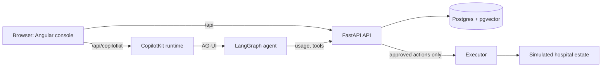

# Healthcare AIOps

**An AI agent that investigates hospital IT incidents, shows its evidence, and is not allowed to press the button.**

When the lab system falls over at 3 a.m., the people on call need two things fast: what broke, and what is safe to do about it. This project builds an agent for that moment. It watches a simulated hospital estate (EHR, lab, imaging, the HL7 interface engine), groups the alert storm into one incident, investigates with real tools, and proposes a fix with the evidence attached. A human approves it. A separate executor carries it out. Then something independent checks whether it worked.

It is IT operations software, not clinical software. It never sees a patient, and all of its data is synthetic.

> **Status:** week 1 of 8 complete. The foundations, the console shell and the LLM usage pipeline are built; the investigation agent arrives in week 3. Progress is tracked in beads (`bd ready`) and written up in a weekly [blog series](docs/blog/series-plan.md).

## Why I'm building it

Three reasons, in order of how loudly they argued.

**A book.** Robert Shimonski's [*AI in Healthcare*](docs/explanation/inspiration.md) is about the unglamorous half of healthcare AI: keeping the systems behind patient care running. Its sharpest warning is that automation can restore a service while the real fault is still sitting there. I wanted to build something that takes that warning seriously.

**Operations.** I have shipped and run production systems for years. Incidents are where you find out whether a system is honest about what it knows. An agent that sounds confident and is wrong is worse than no agent at all.

**A gap.** My portfolio already shows RAG and multi-agent systems. It does not show the parts that decide whether anyone should trust an agent in production: evaluation with real numbers, guardrails against prompt injection, and human approval that cannot be bypassed. This project is built around exactly those.

## What it proves

| Question a reviewer should ask | How the project answers |
|---|---|
| Does the agent find the real cause? | Six scripted failures (S1–S6) with ground truth, 40+ eval cases, root-cause accuracy against a rule-based baseline |
| Can I check its reasoning? | Typed findings: facts, hypotheses and recommendations are separate, and every claim cites an evidence ID |
| What stops it doing something stupid? | The agent has no execution tool. It proposes; a human approves; a scoped executor re-checks and acts |
| What about prompt injection? | Red-team variants hide instructions in logs and runbooks; the target is zero unauthorised actions |
| What does it cost? | Every LLM call is metered (tokens, cost, investigation); unknown spend shows as unknown, never as $0 |

## How it fits together



The details live in [Architecture](docs/explanation/architecture.md) and the [decision records](docs/adr/README.md).

## Run it

```bash
make install     # Python (uv) and Node dependencies
make db          # Postgres in Docker, or set AIOPS_DATABASE_URL to your own
make migrate     # create the schema
make dev         # API, agent, runtime and console together
```

Then open <http://localhost:5173>. The [getting-started tutorial](docs/tutorials/getting-started.md) walks through it properly.

## Built with

Python 3.14 (uv workspace) · FastAPI · LangGraph · AG-UI · CopilotKit · Angular 22 with NgRx SignalStore · PostgreSQL 18 + pgvector · K3s · Flux · Cloudflare Tunnel

## Documentation

Everything is in [`docs/`](docs/README.md), organised as tutorials, how-to guides, reference and explanation. Good starting points:

- [Getting started](docs/tutorials/getting-started.md)
- [Project plan](docs/explanation/healthcare-aiops-plan.md)
- [Deploy to owezzy-db](docs/how-to/deploy-to-owezzy-db.md)

## Contributing

Work happens on git flow branches (`feature/*` from `develop`). Commit messages follow Conventional Commits, and the hooks check them. `uv run cz commit` writes one for you. See [Cut a release](docs/how-to/cut-a-release.md).

## Acknowledgement

Inspired by Robert Shimonski, *AI in Healthcare: How Artificial Intelligence Is Changing IT Operations and Infrastructure Services* (Hoboken, NJ: John Wiley & Sons, 2021; ISBN 978-1-119-68001-7). The book supplies the operational themes; the design, the technology choices and any mistakes are mine.
