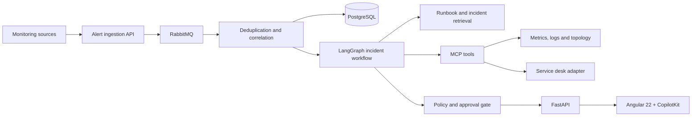
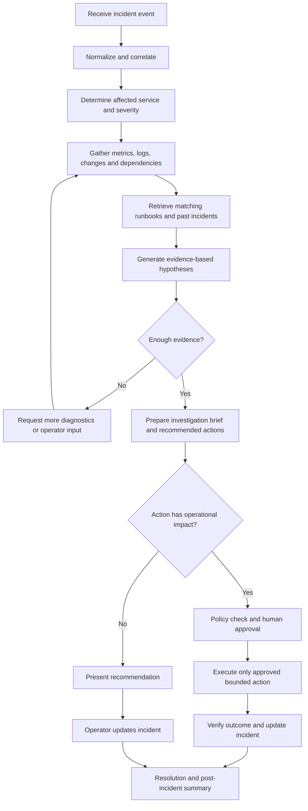
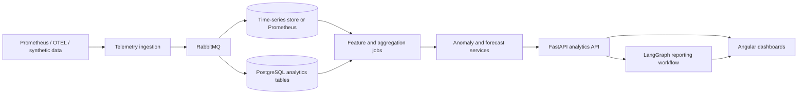
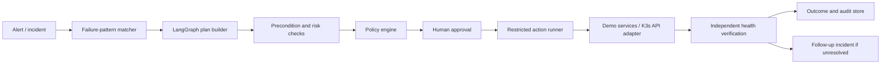
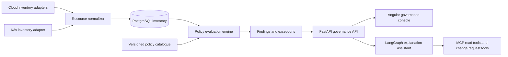
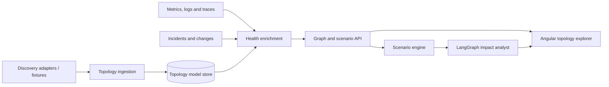
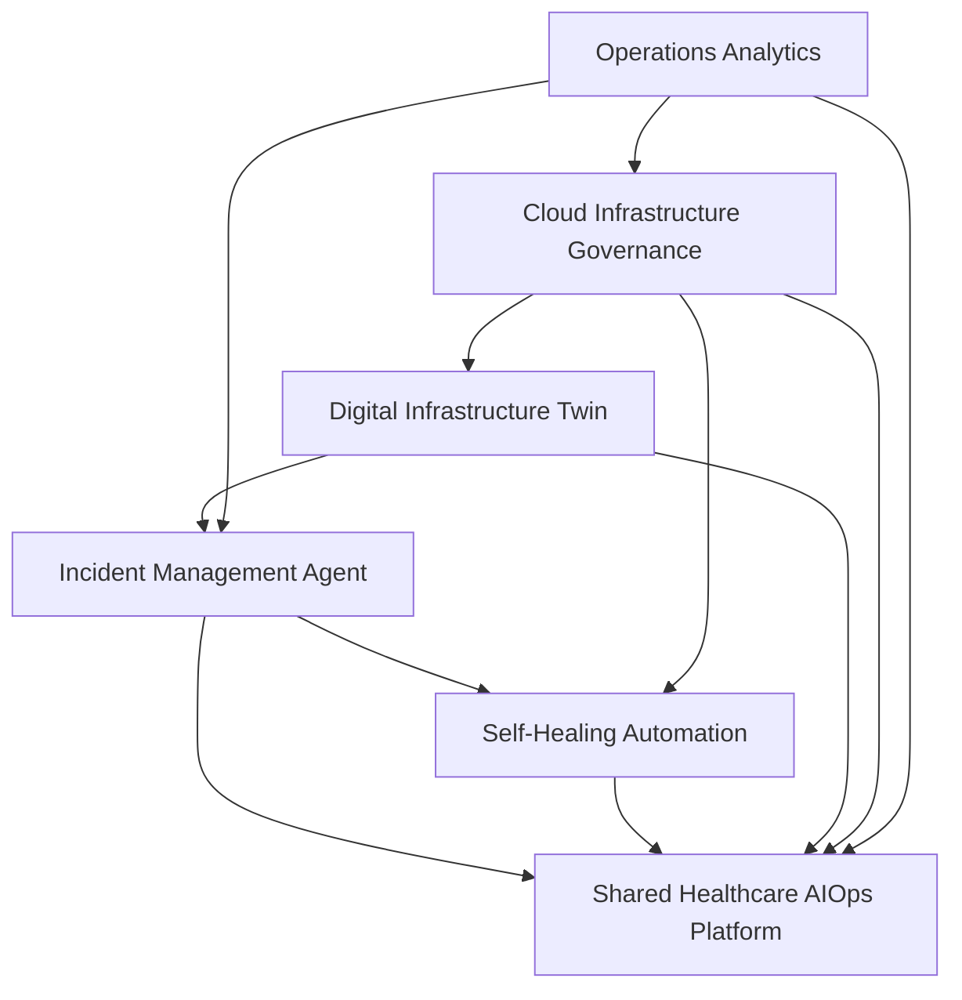

# Healthcare AI & AIOps — Additional Project Plans, Architecture and Design

**Companion to:** `healthcare-aiops-technical-plan.md`  
**Source inspiration:** *AI in Healthcare: How Artificial Intelligence Is Changing IT Operations and Infrastructure Services* — Rob Shimonski (2021)  
**Implementation baseline:** Angular 22, CopilotKit, Python, LangGraph, MCP, TypeScript, PostgreSQL, Redis, RabbitMQ, OpenTelemetry, Prometheus, Grafana, Docker, K3s and a monorepo.

---

## 1. Purpose and scope

This document expands the other project concepts identified from the book's themes. It does not repeat the primary **Healthcare AIOps Intelligence Platform** plan. Instead, it describes five complementary projects that can be built independently or later integrated into that platform:

1. Autonomous IT Incident Management Agent
2. AI Operations Analytics and Predictive Dashboard
3. Self-Healing Infrastructure Automation Engine
4. AI Cloud Infrastructure Governance Platform
5. Digital Infrastructure Twin for Healthcare IT

The book discusses operational reliability, event and fault management, service-desk integration, project planning, performance metrics and reporting, workflow automation, cloud operations, IoT, DataOps, analytics, informatics and convergence across healthcare technology. These are the source-derived problem areas. The particular frameworks and deployment choices in this document are implementation recommendations, not technologies prescribed by the book.

### Shared engineering constraints

- Treat this as healthcare **IT operations software**, not a clinical diagnosis or treatment system.
- Use synthetic telemetry and synthetic infrastructure/service records for the initial build. Do not ingest identifiable patient data.
- Keep the platform's control plane separate from monitored workloads.
- Use a single LangGraph orchestration service initially; add specialized agents only when evaluation demonstrates a need.
- Expose integrations through narrow, typed MCP tools. Do not give an agent arbitrary shell access, unrestricted Kubernetes credentials or direct database write access.
- Require policy checks and human approval before consequential changes. Re-check authorization at execution time.
- Record evidence, decisions, approvals, actions and outcomes in an auditable event trail.
- Design for graceful degradation: monitoring and manual incident workflows must remain usable if the AI provider or agent service is unavailable.

## 2. Shared technical foundation

All five projects can reuse the same baseline. A project can omit components that are not needed for its MVP.

| Layer | Recommended technology | Responsibility |
|---|---|---|
| Web application | Angular 22, TypeScript | Operations console, dashboards, configuration and review workflows |
| AI interaction | CopilotKit | Conversational operations interface and contextual agent interaction |
| Copilot integration | TypeScript Copilot Runtime/service | Frontend-to-agent integration boundary; validate supported Angular integration and versions in a spike |
| API | Python FastAPI | Authentication, authorization, domain APIs and orchestration boundary |
| Agent orchestration | Python LangGraph | Stateful, observable workflows with explicit checkpoints and approval gates |
| Tool integration | MCP server(s) | Typed, permission-scoped access to monitoring, tickets, cloud and Kubernetes operations |
| Event processing | RabbitMQ + Python workers | Buffering, routing, retries and asynchronous processing |
| Operational data | PostgreSQL | Users, services, incidents, policies, actions, audit and configuration records |
| Semantic retrieval | pgvector | Runbooks, incident history and operational knowledge retrieval |
| Cache / short-lived state | Redis | Caching, rate limits and transient coordination |
| Telemetry | OpenTelemetry, Prometheus, Grafana | Metrics, traces, logs and platform observability |
| Deployment | Docker, Helm, K3s | Container packaging and single-node or small-cluster deployment |

### Monorepo layout

```text
healthcare-aiops-lab/
├── apps/
│   └── web/                         # Angular 22 operations console
├── services/
│   ├── api/                         # FastAPI domain API and RBAC
│   ├── copilot-runtime/             # TypeScript CopilotKit integration
│   ├── agent-orchestrator/          # LangGraph workflows
│   ├── mcp-server/                  # Scoped operational tools
│   ├── event-processor/              # Ingestion, correlation and jobs
│   └── policy-engine/               # Action and governance decisions
├── packages/
│   ├── shared-types/
│   ├── api-contracts/
│   ├── ui-models/
│   └── policy-schemas/
├── data/
│   ├── synthetic-telemetry/
│   ├── synthetic-incidents/
│   └── evaluation-datasets/
├── infrastructure/
│   ├── docker/
│   ├── helm/
│   ├── k3s/
│   ├── monitoring/
│   └── scripts/
├── docs/
│   ├── architecture/
│   ├── design/
│   ├── security/
│   ├── operations/
│   └── decisions/
└── tests/
    ├── unit/
    ├── integration/
    ├── e2e/
    └── agent-evaluations/
```

### Shared deployment recommendation

For a demonstration or development environment, start with a VPS running Ubuntu 24.04 LTS, 8 vCPU, 16 GB RAM and 200 GB NVMe storage. Run K3s and use an external model API rather than hosting a local model on this machine. A single VPS is not highly available and must not be presented as a production healthcare deployment. Keep PostgreSQL, Redis, RabbitMQ and internal MCP endpoints on private networks; configure TLS, backups, resource limits, health probes, secrets management and offsite backup retention.

---

# Project 1 — Autonomous IT Incident Management Agent

## 3. Project summary

**Goal:** Build an AI-assisted incident coordinator that consumes operational alerts, groups related events, investigates likely causes, assembles evidence, recommends next steps and helps an operator manage an incident through resolution.

**Problem addressed:** Operations teams receive noisy alerts from multiple systems. Important signals can be separated across monitoring, logs, service dependencies, change records and the service desk. The agent reduces the manual effort required to build a coherent incident picture; it does not replace the incident commander or service owner.

**Primary users:** NOC engineers, SREs, infrastructure engineers, service-desk analysts and incident managers.

### 3.1 MVP capabilities

1. Ingest alerts and events from a simulator or Prometheus Alertmanager webhook.
2. Deduplicate and correlate alerts by service, time window, dependency and fingerprint.
3. Create or update an incident record with severity, affected services and timeline.
4. Retrieve relevant runbooks, recent incidents, deployment changes and service dependencies.
5. Generate a concise investigation brief with evidence-linked hypotheses.
6. Recommend diagnostic steps and an incident communication draft.
7. Allow an authorized operator to approve ticket creation or a bounded remediation request.
8. Track the incident through acknowledged, investigating, mitigated, resolved and post-incident review states.

### 3.2 Architecture



### 3.3 LangGraph workflow design



### 3.4 MCP tool contract

Initial read-only tools:

- `get_service_health(service_id)`
- `get_infrastructure_metrics(service_id, time_range)`
- `search_logs(service_id, query, time_range)`
- `get_service_dependencies(service_id)`
- `get_recent_deployments(service_id, time_range)`
- `search_runbooks(query, service_id)`
- `get_related_incidents(service_id, symptoms)`

Controlled write tools:

- `create_incident(incident_payload)`
- `append_incident_timeline(incident_id, entry)`
- `request_remediation_approval(action_id, rationale, evidence)`

Do not provide a generic `run_command` tool. Any eventual execution tool must map to a small allowlist of predefined actions and verify scope, authorization, approval and preconditions.

### 3.5 Core data model

`Service`, `ServiceDependency`, `Alert`, `AlertFingerprint`, `Incident`, `IncidentEvent`, `Investigation`, `EvidenceItem`, `Hypothesis`, `Runbook`, `RecommendedAction`, `Approval`, `ActionExecution`, `AuditEvent`.

### 3.6 Angular screens

- Incident queue with severity, service, age and status filters.
- Incident workspace with timeline, related alerts, dependency view and evidence panel.
- Copilot side panel for investigation questions and summaries.
- Approval inbox showing action, rationale, risk, evidence and rollback plan.
- Incident review page with timeline export and lessons learned.

### 3.7 Delivery plan

| Phase | Duration | Deliverable |
|---|---:|---|
| Foundation and synthetic alert generator | 1 week | API, schemas, demo services and test events |
| Ingestion and correlation | 1–2 weeks | Alert pipeline, deduplication and incident lifecycle |
| Investigation workflow | 2 weeks | LangGraph retrieval and evidence-backed hypotheses |
| Copilot UI and service desk | 1–2 weeks | Incident workspace and ticket adapter |
| Approval and verification | 1–2 weeks | Human-gated action requests, audit and outcome checks |
| Evaluation and hardening | 1 week | Replay tests, security checks and operational metrics |

### 3.8 Success measures

- Alert-to-incident grouping precision and recall.
- Time to produce an investigation brief.
- Percentage of hypotheses supported by cited evidence.
- Operator acceptance rate of recommendations.
- False escalation rate and duplicate incident reduction.
- Time to acknowledge and mitigate in replay scenarios.
- 100% of consequential actions linked to an authorized approval and audit record.

---

# Project 2 — AI Operations Analytics and Predictive Dashboard

## 4. Project summary

**Goal:** Turn infrastructure and service telemetry into operational insight: trends, service-level indicators, capacity signals, anomaly detection, risk forecasts and management-ready reports.

**Problem addressed:** Metrics are often collected but not translated into a clear operational story. The platform should help teams understand service performance, identify recurring degradation and prioritize improvements. Predictions are advisory and must display uncertainty and supporting data.

**Primary users:** IT operations managers, SREs, infrastructure leads, service owners and technology executives.

### 4.1 MVP capabilities

1. Ingest time-series metrics and service events from Prometheus or generated datasets.
2. Define services, service-level indicators (SLIs), service-level objectives (SLOs) and reporting periods.
3. Show availability, latency, error rate, saturation, incident volume and recovery time.
4. Detect anomalies using transparent statistical baselines before introducing complex ML.
5. Forecast capacity pressure and likely SLO risk with confidence intervals.
6. Explain metric changes using correlated events, deployments and incidents.
7. Generate weekly operational reports with metric definitions and traceable source windows.
8. Allow users to ask questions about dashboards through CopilotKit, with answers grounded in queried data.

### 4.2 Architecture



### 4.3 Analytics design

Start with interpretable methods:

- Rolling averages and percentiles for latency and resource usage.
- Seasonal baselines where enough history exists.
- Robust z-score or median absolute deviation for anomaly flags.
- Linear or seasonal forecasting for an initial capacity estimate.
- Change-point detection for sustained shifts.

Every anomaly or forecast should include the metric, service, time window, baseline, observed value, confidence or uncertainty, and a link to the underlying chart. Avoid presenting a prediction as a confirmed incident.

### 4.4 LangGraph workflow

1. Parse the user's question and identify the relevant service, metric and time range.
2. Resolve metric definitions and access permissions.
3. Query aggregate metrics and related incident/change records.
4. Calculate or retrieve trend and forecast results.
5. Produce a narrative that distinguishes observed facts from interpretation.
6. Return chart-ready data and source references.
7. Ask for clarification when the service or time range is ambiguous.

### 4.5 Core data model

`Service`, `MetricDefinition`, `MetricSampleReference`, `SLI`, `SLO`, `ReportingWindow`, `Anomaly`, `Forecast`, `CapacityProjection`, `IncidentCorrelation`, `Report`, `ReportSection`, `DataQualityCheck`.

### 4.6 Angular screens

- Executive overview: service health, SLO attainment, incident trends and capacity risks.
- Service analytics: latency, traffic, errors, saturation and dependency health.
- Anomaly explorer: detected change, baseline comparison and correlated events.
- Capacity planner: utilization trend, forecast range and threshold dates.
- Report builder: selected services, reporting period and evidence-backed narrative.
- Copilot analytics panel: natural-language questions over authorized metrics.

### 4.7 Delivery plan

| Phase | Duration | Deliverable |
|---|---:|---|
| Metric catalogue and data contracts | 1 week | Service and metric definitions |
| Telemetry ingestion and dashboards | 2 weeks | Live/replayed metrics and core views |
| SLI/SLO reporting | 1 week | Service performance and error budgets |
| Anomaly detection | 1–2 weeks | Baselines, flags and explanations |
| Forecasting and Copilot | 2 weeks | Capacity projections and grounded Q&A |
| Validation | 1 week | Historical replay and report-quality evaluation |

### 4.8 Success measures

- Telemetry completeness and freshness.
- Correctness of SLI/SLO calculations.
- Anomaly precision, recall and false-positive rate on labelled synthetic data.
- Forecast error by metric and forecast horizon.
- Percentage of generated claims traceable to source metrics.
- Time saved preparing recurring operational reports.

---

# Project 3 — Self-Healing Infrastructure Automation Engine

## 5. Project summary

**Goal:** Detect known operational failure patterns and safely execute pre-approved recovery workflows, then verify whether the service recovered and whether a deeper repair ticket is still required.

**Problem addressed:** Repetitive incidents can consume operator time. Bounded automation can restore service quickly, but restoring service is not necessarily the same as fixing the underlying cause. The book explicitly warns about this distinction: a service may be restored while a faulty component still needs replacement and follow-up work.

**Primary users:** SREs, infrastructure engineers, platform engineers and change approvers.

### 5.1 MVP capabilities

1. Maintain a catalogue of known failure patterns and approved runbooks.
2. Detect a matching condition from alerts and metrics.
3. Evaluate preconditions, blast radius, service criticality and maintenance windows.
4. Generate an execution plan with expected effect and rollback steps.
5. Require approval for all non-trivial actions in the MVP.
6. Execute a narrowly defined action through a dedicated runner.
7. Verify recovery using independent health checks.
8. Open or update a follow-up incident when the root cause remains unresolved.
9. Record before/after telemetry, approval and execution evidence.

### 5.2 Example bounded workflows

- Restart a non-critical demo service when health checks fail and no deployment is in progress.
- Scale a stateless demo deployment within a configured minimum and maximum replica count.
- Clear a known, bounded application cache through an application API.
- Re-route a synthetic workload to a healthy replica pool.

Do not automate destructive database operations, storage replacement, clinical device controls, broad cluster upgrades or arbitrary command execution in the initial project.

### 5.3 Architecture



### 5.4 Safety state machine

`Detected → Matched → PlanGenerated → PreconditionsPassed → AwaitingApproval → Approved → Executing → Verifying → Succeeded | Failed | RolledBack | Escalated`.

A workflow must stop if preconditions change, the approval expires, the target differs from the approved target, the action exceeds its configured scope, or verification fails. A failed verification should trigger rollback when safe and escalate to a human.

### 5.5 Policy model

Each action definition should declare:

- Target resource types and permitted namespaces.
- Exact operation and allowed parameter ranges.
- Required role and approval policy.
- Maximum frequency and cooldown period.
- Preconditions and postconditions.
- Timeout and retry limit.
- Rollback operation, if one exists.
- Risk classification and audit requirements.

The policy engine, not the language model, makes the authorization decision. The model may propose a workflow; it cannot expand the action catalogue or waive policy.

### 5.6 Core data model

`FailurePattern`, `Runbook`, `AutomationAction`, `ActionParameterSchema`, `Precondition`, `Postcondition`, `RiskAssessment`, `Approval`, `Execution`, `VerificationResult`, `RollbackExecution`, `FollowUpIncident`, `AuditEvent`.

### 5.7 Delivery plan

| Phase | Duration | Deliverable |
|---|---:|---|
| Runbook catalogue | 1 week | Versioned, typed runbooks and action schemas |
| Detection and planning | 1–2 weeks | Pattern matcher and LangGraph plan generation |
| Policy and approval | 1–2 weeks | Risk rules, RBAC and approval UI |
| Restricted execution runner | 2 weeks | One or two safe demo actions |
| Verification and rollback | 1 week | Independent health checks and escalation |
| Simulation and evaluation | 1 week | Fault injection, replay and safety tests |

### 5.8 Success measures

- Recovery success rate for supported scenarios.
- False-positive automation trigger rate.
- Percentage of actions blocked when preconditions fail.
- Percentage of actions with valid approval and complete audit trail.
- Mean time to recover for supported incidents.
- Rate of recurrence after apparent recovery.
- Percentage of recovered-but-not-fixed cases that generate follow-up work.

---

# Project 4 — AI Cloud Infrastructure Governance Platform

## 6. Project summary

**Goal:** Provide a unified view of cloud and cluster resources, evaluate configurations against organizational policies, explain risks and guide operators through compliant remediation.

**Problem addressed:** Healthcare environments may combine on-premises infrastructure, hosted services, cloud platforms and managed providers. Governance must make configuration, security, availability, ownership and operational responsibility visible. This project focuses on infrastructure governance, not clinical data governance.

**Primary users:** Cloud engineers, security engineers, platform teams, IT governance, auditors and technology managers.

### 6.1 MVP capabilities

1. Inventory cloud-like resources and K3s workloads using read-only adapters or synthetic fixtures.
2. Normalize resource metadata, ownership, environment, region and criticality.
3. Evaluate policy rules such as public exposure, missing encryption metadata, absent backups, excessive privileges, missing ownership and unsupported images.
4. Assign severity and explain each finding with the exact resource and policy clause.
5. Track exceptions with owner, rationale, expiry and compensating control.
6. Recommend remediation steps and generate change requests.
7. Require approval and change-window checks before any write operation.
8. Produce governance reports and evidence exports.

### 6.2 Architecture



### 6.3 Policy design

Represent policies as versioned, testable rules. A policy finding should contain:

- Policy identifier and version.
- Resource identifier and resource owner.
- Observed configuration and expected configuration.
- Severity and rationale.
- Evidence timestamp and source adapter.
- Recommended remediation and possible operational impact.
- Exception status, approver and expiry date.

Start with a small policy set: public endpoint exposure, missing backup declaration, missing owner, unpinned container image, excessive service-account permissions and missing resource limits. Avoid claiming compliance with a named regulatory framework until the relevant control mapping has been independently reviewed.

### 6.4 AI assistant responsibilities

The assistant can explain a finding, summarize affected resources, locate the relevant policy, draft a change request and describe likely impact. It must not mark a finding compliant, create an exception, or modify infrastructure by itself. Those transitions belong to deterministic policy and approval services.

### 6.5 Core data model

`CloudAccount`, `Cluster`, `Resource`, `ResourceRelationship`, `ResourceOwner`, `Policy`, `PolicyVersion`, `PolicyEvaluation`, `Finding`, `ExceptionRequest`, `ExceptionApproval`, `RemediationRequest`, `ChangeWindow`, `AuditEvent`.

### 6.6 Angular screens

- Resource inventory with filters by environment, owner, provider and criticality.
- Governance posture overview and finding trends.
- Finding detail with evidence, policy text and remediation guidance.
- Exception workflow with expiry and compensating controls.
- Change request and approval inbox.
- Audit and export centre.

### 6.7 Delivery plan

| Phase | Duration | Deliverable |
|---|---:|---|
| Resource model and fixtures | 1 week | Normalized inventory and synthetic resources |
| Read-only inventory adapters | 1–2 weeks | K3s adapter and one cloud adapter or mock |
| Policy engine | 2 weeks | Versioned rules and finding lifecycle |
| Governance UI and reports | 1–2 weeks | Posture dashboard and evidence views |
| AI explanations and change requests | 1–2 weeks | Grounded assistant and approval flow |
| Security and audit review | 1 week | Permission tests and evidence export |

### 6.8 Success measures

- Inventory coverage and freshness.
- Policy evaluation correctness against labelled fixtures.
- Finding precision and duplicate rate.
- Time to assign an owner and resolve a finding.
- Exception expiry compliance.
- Percentage of remediation changes with approval and audit evidence.

---

# Project 5 — Digital Infrastructure Twin for Healthcare IT

## 7. Project summary

**Goal:** Build a continuously updated model of healthcare IT services, their dependencies, infrastructure components, telemetry and operational events. Use it to understand blast radius, explore failure scenarios and support capacity and resilience planning.

**Problem addressed:** AIOps depends on accurate knowledge of what systems exist, how they relate and which services depend on them. A digital twin makes those relationships visible and lets teams reason about operational impact before making changes.

**Primary users:** Enterprise architects, infrastructure engineers, service owners, SREs, operations managers and continuity planners.

### 7.1 MVP capabilities

1. Model services, applications, clusters, nodes, databases, networks and external dependencies.
2. Import or generate topology relationships.
3. Attach health, performance and incident state to each node.
4. Display service dependency graphs and upstream/downstream relationships.
5. Calculate potential blast radius for a failed component.
6. Run scenario simulations such as node loss, database latency, network partition or provider outage.
7. Compare current and proposed deployment topologies.
8. Generate an impact brief with assumptions and uncertainty clearly shown.

### 7.2 Architecture



For the first release, PostgreSQL tables with recursive queries or a graph extension are sufficient. Adopt a dedicated graph database only if graph query complexity and scale justify the operational cost.

### 7.3 Domain model

- **Node:** a service, application, infrastructure resource or external dependency.
- **Relationship:** depends-on, hosted-on, connects-to, replicates-to or monitored-by.
- **Observation:** health, metric, event or configuration state at a timestamp.
- **Scenario:** a hypothetical failure or planned change.
- **Impact result:** affected nodes, dependency paths, estimated severity and assumptions.

### 7.4 Scenario engine

Start with deterministic graph traversal and explicit rules. Example: if a database node is unavailable, traverse reverse `depends-on` relationships to list affected services. Enrich the result with criticality, redundancy and current health. Do not use an LLM to calculate the graph traversal itself; use the model to explain the deterministic result and identify missing assumptions.

### 7.5 Angular screens

- Interactive topology map with service and infrastructure layers.
- Node detail drawer with owner, health, dependencies and recent events.
- Blast-radius explorer for a selected node.
- Scenario builder with failure type and affected component.
- Before/after topology comparison.
- Copilot panel for questions such as “Which services depend on this database?”

### 7.6 Delivery plan

| Phase | Duration | Deliverable |
|---|---:|---|
| Domain model and synthetic topology | 1 week | Service/resource graph and fixtures |
| Discovery and ingestion | 1–2 weeks | Import pipeline and topology API |
| Visualization | 2 weeks | Searchable interactive topology UI |
| Health and event enrichment | 1–2 weeks | Live/replayed telemetry on graph nodes |
| Blast-radius and scenarios | 2 weeks | Deterministic impact engine |
| Copilot explanations and evaluation | 1 week | Grounded impact summaries and test scenarios |

### 7.7 Success measures

- Percentage of known resources represented in the model.
- Relationship accuracy against a labelled reference topology.
- Topology freshness and stale-edge rate.
- Blast-radius precision and recall in simulated failures.
- Time required to identify affected services.
- Percentage of generated impact statements linked to graph paths or observations.

---

## 8. Cross-project design standards

### 8.1 Identity and authorization

Use OIDC-compatible authentication where possible. Enforce RBAC in FastAPI and the policy service. Suggested roles:

- `viewer`: read dashboards, incidents and inventory.
- `operator`: investigate and update operational records.
- `incident_commander`: coordinate incidents and approve incident workflow steps.
- `change_approver`: approve defined operational changes.
- `platform_admin`: manage integrations, policies and configuration.
- `auditor`: read audit and evidence records.

The UI may hide unavailable actions, but backend authorization is authoritative. MCP tools must apply the same identity and scope restrictions.

### 8.2 Audit and evidence

For every agent run, store the user/request identity, workflow version, model/provider metadata where available, tool calls, tool outputs or safe references, retrieved evidence identifiers, policy decisions, approvals, action results and final outcome. Redact secrets and avoid storing sensitive payloads unnecessarily.

### 8.3 Agent evaluation

Create a fixed synthetic evaluation set for each project. Include normal cases, ambiguous cases, missing data, conflicting telemetry, stale runbooks, permission-denied actions, tool failures and adversarial instructions inside log text. Measure task success, evidence grounding, tool selection, policy compliance, refusal/abstention quality, latency and cost. Treat logs and retrieved documents as untrusted data, never as instructions that override system policy.

### 8.4 Reliability and observability

- Trace API requests, agent runs, tool calls and asynchronous jobs with OpenTelemetry.
- Use correlation IDs across alerts, incidents, agent runs and actions.
- Make event consumers idempotent and use bounded retries with dead-letter queues.
- Define readiness and liveness probes for every service.
- Keep AI features optional to core monitoring and incident record workflows.
- Monitor model-provider latency, error rate, token usage and tool-call failure rate.

### 8.5 Data protection

- Use synthetic operational data for portfolio demonstrations.
- Do not ingest patient identifiers, clinical notes or medical records into these projects.
- Encrypt data in transit and at rest where supported.
- Apply retention limits and least-privilege access.
- Keep secrets out of prompts, logs, source control and browser storage.
- Review local legal, contractual and organizational requirements before any real healthcare deployment.

---

## 9. How the five projects fit together

These projects are complementary modules, not five separate platforms that must all be built at once.



- The **Digital Infrastructure Twin** supplies service context and dependency relationships.
- **Operations Analytics** supplies performance trends, SLO risk and capacity signals.
- The **Incident Management Agent** combines alerts, topology, telemetry and runbooks into an investigation.
- **Cloud Governance** supplies configuration posture, policy constraints and change controls.
- **Self-Healing Automation** executes a small set of approved recovery workflows and verifies the outcome.

## 10. Recommended build sequence

For a portfolio project, avoid implementing all five at once. Build reusable foundations and then deliver the projects in this order:

| Order | Project | Why this order |
|---:|---|---|
| 1 | AI Operations Analytics and Predictive Dashboard | Establishes telemetry ingestion, service catalogue, metrics and useful dashboards |
| 2 | Digital Infrastructure Twin | Adds dependency context that improves incident analysis and impact assessment |
| 3 | Autonomous IT Incident Management Agent | Demonstrates LangGraph, CopilotKit, MCP, retrieval and operational reasoning |
| 4 | AI Cloud Infrastructure Governance Platform | Adds policy evaluation, ownership, exceptions and audit workflows |
| 5 | Self-Healing Infrastructure Automation Engine | Comes last because safe execution depends on reliable telemetry, context, policy and approval foundations |

A practical first release could combine Projects 1 and 2 at reduced scope: basic operational analytics plus incident investigation. Add topology and controlled remediation only after the read-only workflows are reliable.

## 11. Suggested repository milestones

1. **Foundation:** monorepo, Angular shell, FastAPI, PostgreSQL, Redis, RabbitMQ, CI and K3s deployment.
2. **Telemetry:** synthetic service fleet, OpenTelemetry, Prometheus, event ingestion and dashboards.
3. **Knowledge and topology:** service catalogue, dependency model, runbook retrieval and pgvector.
4. **Agent layer:** CopilotKit integration spike, LangGraph workflow, MCP read-only tools and evaluation harness.
5. **Governance:** RBAC, policy engine, approval records, audit trail and exception workflow.
6. **Automation:** restricted runner, bounded actions, verification, rollback and fault-injection tests.

## 12. Key risks and mitigations

| Risk | Mitigation |
|---|---|
| Incorrect AI diagnosis | Require evidence references, show uncertainty and retain operator ownership |
| Unsafe infrastructure action | Use allowlisted actions, deterministic policy checks, approval and execution-time revalidation |
| Poor telemetry quality | Validate schemas, track freshness and completeness, and surface missing data |
| Stale topology | Record source and observation time; reconcile discovery data regularly |
| Alert noise | Deduplicate, correlate and tune against labelled replay data |
| Model/provider outage | Keep core monitoring and ticket workflows functional without AI |
| Overly broad scope | Deliver one vertical slice at a time and reuse shared foundations |
| False compliance claims | Map controls carefully and obtain independent review before claiming regulatory compliance |
| Single VPS failure | Treat VPS as development/demo only; define backup, restore and recovery procedures |

## 13. Source alignment and interpretation

The book's chapter structure supports the problem areas used to shape these project concepts:

- Chapters 1–2: healthcare IT growth, operational reliability and the relationship between technology services and clinical operations.
- Chapter 3: operational infrastructure strategy, scoping, product selection, event and fault management, and integration with service management/APM.
- Chapter 4: project planning, team responsibilities, milestones and communication.
- Chapter 5: service performance metrics, KPIs, critical success factors, dashboards and reporting.
- Chapter 6: workflows, process engineering, warning detection, incident engagement, event handling and automation.
- Chapter 7: cloud operations, hosted services, deployment choices and cloud security in healthcare environments.
- Chapters 8–9: telehealth, IoT, Big Data, DataOps, analytics, informatics and convergence across healthcare IT systems.
- Appendix: sample AIOps use cases and operational problems.

The book provides the operational themes and cautions, not a ready-made software specification for these five products. The project scopes, data models, diagrams, acceptance measures and selected technologies above are proposed engineering designs derived from those themes. In particular, the book's warning that service restoration may not resolve the underlying fault is reflected in the self-healing project's mandatory verification and follow-up incident design.

## 14. Decisions to confirm before implementation

- Which project should be the next standalone portfolio deliverable?
- Which monitoring source will be used first: Prometheus, OpenTelemetry demo data or a custom simulator?
- Which service-desk integration should be emulated or connected first?
- Which cloud provider, if any, should the governance adapter target?
- Should the initial topology store remain PostgreSQL, or is there a demonstrated need for a graph database?
- Which exact CopilotKit Angular integration path and package versions pass the initial compatibility spike?
- What is the approved set of safe remediation actions for the demo environment?

---

**Document status:** Architecture and design proposal. It is not a production deployment specification, clinical system validation, security certification or regulatory compliance assessment.
