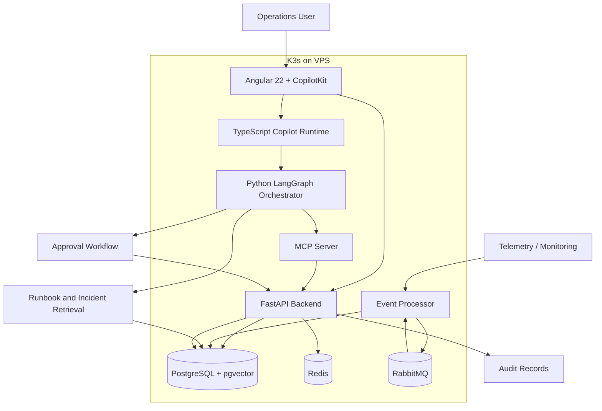
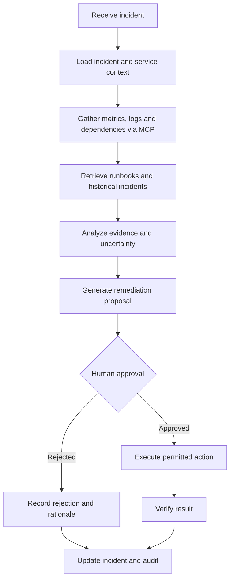

# Healthcare AIOps Intelligence Platform

## Project Plan, Architecture and Design Specification

**Status:** Architecture baseline  
**Delivery target:** 12-week MVP  
**Repository:** Monorepo  
**Frontend:** Angular 22  
**AI interface:** CopilotKit  
**Agent orchestration:** Python + LangGraph  
**Tool integration:** Model Context Protocol (MCP)  
**Deployment:** K3s on a VPS

---

## 1. Project overview

### 1.1 Vision

Build an AI-powered healthcare IT operations platform that monitors infrastructure, detects operational anomalies, correlates events, investigates incidents, recommends remediation and supports controlled automation.

The platform demonstrates how AI can improve the availability, reliability and efficiency of healthcare technology services. It is an **IT operations platform, not a clinical decision-support system**. The MVP uses synthetic infrastructure and operational data rather than real patient information.

### 1.2 Problem statement

Healthcare IT environments depend on interconnected systems that must remain available around the clock. Traditional monitoring tools can produce disconnected alerts, require manual investigation and depend on engineers to coordinate incident response.

The platform addresses:

1. Fragmented monitoring and limited infrastructure visibility.
2. Alert noise and difficulty identifying related events.
3. Slow incident investigation and root-cause analysis.
4. Manual remediation and inconsistent operational procedures.
5. Limited insight into service reliability and operational trends.

### 1.3 Objectives

- Provide a consolidated view of infrastructure and service health.
- Ingest, normalize and correlate infrastructure events.
- Identify abnormal behavior and emerging operational risks.
- Use an AI agent to investigate incidents and explain findings.
- Provide remediation recommendations with supporting evidence.
- Require human approval before consequential infrastructure changes.
- Track incidents, remediation outcomes and operational performance.
- Deploy the platform to a self-managed Kubernetes environment.

### 1.4 MVP scope

**Included**

- Infrastructure and service monitoring.
- Event ingestion and normalization.
- Incident detection and correlation.
- AI-assisted investigation.
- CopilotKit conversational operations interface.
- MCP-based tool access.
- Remediation recommendations.
- Human approval workflow.
- Simulated remediation and audit history.
- Operational analytics dashboard.

**Excluded from the initial MVP**

- Real hospital system integrations.
- Access to patient records or clinical systems.
- Autonomous production infrastructure changes.
- Multi-region Kubernetes deployment.
- Clinical diagnosis or treatment recommendations.

---

## 2. Functional design

The platform is organized around six functional modules.

| Module | Responsibilities |
|---|---|
| Infrastructure monitoring | Collect metrics, logs and service health |
| Event intelligence | Normalize, classify and correlate events |
| Incident management | Create, prioritize and track incidents |
| AI operations assistant | Investigate incidents and explain findings |
| Remediation governance | Propose, approve and record actions |
| Operations analytics | Display trends, availability and performance |

### 2.1 Infrastructure monitoring

Monitor simulated or instrumented services such as:

- Application servers.
- Databases.
- Kubernetes workloads.
- Network services.
- API endpoints.
- Storage and compute resources.

Initial metrics include CPU utilization, memory utilization, disk usage, request latency, error rates, availability and container restart counts.

### 2.2 Event intelligence

The event processor will:

1. Receive telemetry and monitoring events.
2. Validate and normalize incoming data.
3. Associate events with infrastructure assets.
4. Identify duplicate or related alerts.
5. Apply severity and priority rules.
6. Create or update incidents.
7. Make relevant context available to the AI agent.

### 2.3 Incident management

Every incident should contain:

- Incident ID.
- Title and description.
- Severity and priority.
- Affected service or infrastructure asset.
- First detected and last updated timestamps.
- Related alerts and events.
- Investigation status.
- AI-generated findings.
- Recommended actions.
- Approval and remediation history.
- Resolution status.

### 2.4 AI operations assistant

The assistant should answer questions such as:

- What is currently unhealthy?
- Why did this service become unavailable?
- Which infrastructure components are affected?
- Have similar incidents occurred?
- What evidence supports the suspected root cause?
- What remediation would you recommend?
- Has the proposed remediation been approved?

Responses must distinguish confirmed observations from hypotheses and recommendations.

### 2.5 Remediation governance

Remediation follows this workflow:

1. Incident detected.
2. AI investigation.
3. Remediation plan generated.
4. Human approval required.
5. Controlled execution.
6. Verification and audit.

A successful service restart does not necessarily mean the underlying problem has been fixed. The system must preserve the incident, record the action and identify any outstanding corrective work. This distinction reflects the book's discussion of self-healing operations.

---

## 3. System architecture

### 3.1 High-level architecture

The architecture separates the user interface, AI orchestration, operational APIs, tool execution and data infrastructure.



### 3.2 Component responsibilities

**Angular 22 frontend**

Responsible for:

- Operations dashboard.
- Service and infrastructure inventory.
- Incident management screens.
- Alert and event timelines.
- AI assistant interface.
- Approval and remediation screens.
- Analytics and reporting.

Use standalone components, feature-based organization, typed API clients and a consistent state-management approach. Use NgRx where shared state and event-driven workflows justify it rather than introducing it everywhere.

**CopilotKit runtime**

Responsible for:

- Connecting the Angular assistant interface to agent capabilities.
- Streaming assistant responses.
- Handling conversational interaction.
- Exposing approved application actions to the assistant.

Use a TypeScript Copilot Runtime as the initial integration boundary. Keep LangGraph in Python and connect it through a controlled backend integration. Verify the selected CopilotKit Angular package and runtime versions together in an initial technical spike.

**FastAPI backend**

Responsible for:

- Authentication and authorization.
- Incident and service APIs.
- Event ingestion endpoints.
- Approval workflows.
- Audit records.
- Agent invocation endpoints.
- Business rules and data access.

**LangGraph orchestrator**

Responsible for:

- Managing the agent's investigation workflow.
- Maintaining investigation state.
- Selecting appropriate tools.
- Evaluating tool outputs.
- Producing evidence-based findings.
- Generating remediation proposals.
- Pausing for human approval.

**MCP server**

Responsible for exposing well-defined operational capabilities to the agent. MCP is the tool integration protocol, not the authorization system: every operation must still be checked by the backend.

**Event processor**

Responsible for handling incoming telemetry asynchronously, deduplicating events, applying correlation rules and creating incident records.

### 3.3 AI agent design

Start with one orchestrating agent rather than multiple autonomous agents. This makes the first version easier to evaluate, debug and govern.



The agent should:

- Gather evidence before recommending actions.
- Cite relevant observations, logs, metrics or runbooks in its findings.
- Distinguish confirmed facts from hypotheses.
- State uncertainty and missing information.
- Explain the risk and expected outcome of each proposed action.
- Pause when approval is required.
- Verify outcomes instead of assuming a tool call succeeded.

### 3.4 Initial MCP tool catalogue

| Tool | Permission | Purpose |
|---|---|---|
| `get_service_health` | Read | Retrieve service status |
| `get_infrastructure_metrics` | Read | Retrieve infrastructure metrics |
| `search_logs` | Read | Search relevant logs |
| `get_related_incidents` | Read | Find similar incidents |
| `get_service_dependencies` | Read | Inspect service relationships |
| `search_runbooks` | Read | Retrieve operating procedures |
| `create_incident` | Controlled write | Create an incident |
| `generate_remediation_plan` | Controlled write | Save a proposal |
| `request_remediation_approval` | Controlled write | Request authorization |
| `execute_remediation` | Restricted write | Perform an approved operation |

The agent must never receive unrestricted shell access, Kubernetes administrator credentials or unrestricted database access.

### 3.5 Event and data flow

1. Monitoring agents produce telemetry.
2. Telemetry is sent to the ingestion API or monitoring pipeline.
3. The event processor validates and normalizes events.
4. RabbitMQ distributes event-processing work.
5. The processor correlates related events.
6. An incident is created or updated in PostgreSQL.
7. The LangGraph agent receives an investigation request.
8. The agent gathers evidence through MCP.
9. The frontend displays its findings.
10. An authorized operator reviews and approves any remediation.
11. The execution service performs the approved action.
12. The system verifies the result and records the audit trail.

### 3.6 Data architecture

Use PostgreSQL as the main transactional database.

| Entity | Purpose |
|---|---|
| `users` | User accounts |
| `roles` | Permission definitions |
| `services` | Monitored services |
| `infrastructure_assets` | Hosts, containers and resources |
| `events` | Normalized operational events |
| `incidents` | Incident records |
| `incident_events` | Incident-to-event relationships |
| `investigations` | AI investigation records |
| `remediation_plans` | Proposed corrective actions |
| `approvals` | Human authorization decisions |
| `remediation_executions` | Execution outcomes |
| `audit_logs` | Security and operational audit trail |
| `runbooks` | Operational procedures |
| `knowledge_embeddings` | Vector representations for retrieval |

Use pgvector for semantic retrieval of runbooks and historical incident knowledge. Redis should handle caching and short-lived state, not become the authoritative store for incidents or approvals.

---

## 4. Application design

### 4.1 Main user experience

The application should have six main navigation areas:

1. **Operations Overview:** Service availability, infrastructure health, open incidents, event volume and operational trends.
2. **Infrastructure Monitoring:** Resource utilization, service status, telemetry and infrastructure inventory.
3. **Incident Management:** Incident queues, severity, affected services, investigation progress and resolution.
4. **AI Operations Assistant:** Conversational investigation, evidence, explanations and remediation recommendations.
5. **Approvals and Governance:** Pending approvals, action details, risks, approval history and audit records.
6. **Analytics and Reports:** Availability, incident trends, MTTR, alert volumes and remediation outcomes.

### 4.2 AI assistant interaction design

The assistant should return structured operational findings rather than unsupported paragraphs.

Example response structure:

**Incident:** Database service latency  
**Severity:** High  
**Assessment:** Database response times have increased significantly. The application API is also reporting elevated request latency.

**Evidence**

- Database CPU utilization: 94%.
- API response latency: 3.2 seconds.
- Database connection pool: 98% utilized.
- Two related alerts detected.

**Likely cause:** Database resource saturation or connection exhaustion. Further inspection is required before confirming root cause.

**Recommended actions**

1. Inspect long-running queries.
2. Review connection pool configuration.
3. Check recent deployment changes.
4. Consider a controlled service restart only if justified.

The interface should include source references, timestamps, confidence or uncertainty indicators, and links to the underlying incident evidence. Any consequential action must display its approval status.

---

## 5. Infrastructure and deployment design

### 5.1 VPS recommendation

Recommended starting allocation for the MVP:

| Resource | Recommendation |
|---|---|
| CPU | 8 vCPU |
| Memory | 16 GB RAM |
| Storage | 200 GB NVMe |
| Operating system | Ubuntu 24.04 LTS |
| Kubernetes distribution | K3s |
| Deployment | Single VPS for MVP |

This is indicative project sizing, not a verified provider quote. AI model inference should initially use an external model API rather than compete for VPS resources.

A single VPS is a development and demonstration environment, not a highly available production healthcare deployment. A host failure would take down the entire platform.

### 5.2 Kubernetes design

Use K3s with the following logical namespaces:

| Namespace | Workloads |
|---|---|
| `ingress` | Ingress controller, TLS certificates |
| `frontend` | Angular application |
| `application` | FastAPI, Copilot Runtime, LangGraph, MCP |
| `messaging` | RabbitMQ |
| `data` | PostgreSQL, Redis |
| `observability` | Prometheus, Grafana, OpenTelemetry Collector |

Deploy each service as an independent container. Use Helm charts for repeatable deployment and environment-specific configuration.

### 5.3 Infrastructure requirements

- Ubuntu VPS with SSH key authentication.
- K3s installation and cluster configuration.
- Domain name and DNS records.
- HTTPS certificates and ingress.
- Container registry.
- Persistent volumes for PostgreSQL and other stateful services.
- Automated offsite database backups.
- Secrets management.
- Resource requests and limits.
- Readiness and liveness probes.
- Network policies.
- Centralized application logs.
- Prometheus and Grafana monitoring.
- GitHub Actions build and deployment workflows.

Do not expose PostgreSQL, Redis, RabbitMQ or internal MCP endpoints directly to the public internet.

### 5.4 Security design

Security must be part of the platform architecture rather than a final implementation task.

| Control | Design |
|---|---|
| Authentication | Secure user authentication |
| Authorization | Role-based access control |
| API security | Authentication, validation and rate limiting |
| Secrets | Kubernetes Secrets with appropriate external protection |
| Network | Private internal service communication |
| Agent permissions | Least-privilege tool access |
| Approvals | Backend-enforced authorization |
| Audit | Tamper-resistant action history |
| Data | Synthetic data for MVP; encryption at rest and in transit |
| Recovery | Tested backup and restore process |

Suggested roles:

- **Administrator:** Manage platform configuration and users.
- **Operations Engineer:** Monitor services and investigate incidents.
- **Approver:** Authorize permitted remediation.
- **Viewer:** Read dashboards and reports.

An AI agent must not be able to approve its own proposed action. Approval must be enforced by backend authorization and checked again at execution time.

---

## 6. Monorepo design

```text
healthcare-aiops/
│
├── apps/
│   └── web/                       # Angular 22
│
├── services/
│   ├── api/                       # FastAPI
│   ├── copilot-runtime/           # TypeScript runtime
│   ├── agent-orchestrator/        # Python LangGraph
│   ├── mcp-server/                # MCP operational tools
│   └── event-processor/           # Event ingestion/correlation
│
├── packages/
│   ├── shared-types/              # Shared TypeScript types
│   ├── api-contracts/             # API schemas and contracts
│   └── ui-models/                 # Frontend view models
│
├── data/
│   ├── synthetic-telemetry/
│   └── evaluation-datasets/
│
├── infrastructure/
│   ├── docker/
│   ├── kubernetes/
│   ├── helm/
│   ├── monitoring/
│   └── scripts/
│
├── docs/
│   ├── architecture/
│   ├── design/
│   ├── decisions/
│   ├── security/
│   ├── api/
│   └── operations/
│
├── tests/
│   ├── integration/
│   ├── e2e/
│   └── agent-evaluations/
│
├── .github/
│   └── workflows/
│
├── README.md
├── CONTRIBUTING.md
└── LICENSE
```

### Repository design principles

- Keep services independently deployable.
- Share API contracts rather than tightly coupling services.
- Keep Python dependencies separate from Node.js dependencies.
- Version MCP tool schemas.
- Keep infrastructure configuration in version control.
- Separate local development, staging and production configuration.
- Store no credentials or production secrets in Git.

---

## 7. Implementation plan

A 12-week MVP is a reasonable planning target for a focused solo development effort. It is an estimate, not a guaranteed delivery date.

### Weeks 1–2: Architecture and foundation

- Confirm system architecture and API contracts.
- Establish monorepo and development standards.
- Create Angular 22 application.
- Set up FastAPI and TypeScript Copilot Runtime.
- Create initial PostgreSQL schema.
- Establish local container-based development.

**Milestone:** Running application foundation.

### Weeks 3–4: Monitoring and event ingestion

- Implement service and infrastructure inventory.
- Add synthetic telemetry generation.
- Implement event ingestion and normalization.
- Integrate RabbitMQ.
- Create initial service health dashboard.
- Implement basic alert thresholds.

**Milestone:** Monitoring pipeline operational.

### Weeks 5–6: Incident intelligence

- Implement event correlation.
- Build incident lifecycle APIs.
- Add incident timelines and severity.
- Add historical incident search.
- Implement operational analytics.

**Milestone:** End-to-end incident management.

### Weeks 7–8: LangGraph and CopilotKit

- Build the LangGraph investigation workflow.
- Implement MCP server and read-only tools.
- Connect CopilotKit to the agent.
- Add evidence-based AI responses.
- Integrate runbook retrieval using pgvector.
- Add agent evaluation datasets.

**Milestone:** AI-assisted investigation.

### Weeks 9–10: Governance and remediation

- Implement remediation plan generation.
- Add role-based approval workflow.
- Implement simulated remediation tools.
- Record execution and verification results.
- Add audit history and permission tests.

**Milestone:** Governed remediation workflow.

### Weeks 11–12: K3s deployment and hardening

- Provision VPS and install K3s.
- Deploy services using Helm.
- Configure TLS, DNS and ingress.
- Add Prometheus and Grafana.
- Configure backups and restore tests.
- Complete security and agent evaluations.
- Prepare documentation and portfolio demonstration.

**Milestone:** Deployed MVP.

### 7.1 Sprint acceptance criteria

| Sprint | Completion evidence |
|---|---|
| 1 | Frontend and backend start successfully; database migrations run |
| 2 | Synthetic telemetry appears in the monitoring dashboard |
| 3 | Events can be normalized and correlated |
| 4 | An incident can be created, viewed and updated |
| 5 | Agent can investigate using read-only MCP tools |
| 6 | Assistant returns evidence-backed findings |
| 7 | Remediation proposal can be generated and stored |
| 8 | Approval and rejection workflows work with RBAC |
| 9 | Approved simulated remediation can be executed and verified |
| 10 | Full application deploys to K3s |
| 11 | Monitoring, backup and recovery tests pass |
| 12 | End-to-end demonstration and evaluation report are complete |

---

## 8. Quality, evaluation and operational metrics

### 8.1 Platform metrics

| Metric | What it measures |
|---|---|
| Service availability | Percentage of time a service is operational |
| MTTD | Mean time to detect an incident |
| MTTR | Mean time to resolve an incident |
| Alert volume | Number of generated alerts |
| Alert correlation rate | Related events grouped together |
| Incident recurrence | Repeated incidents |
| Remediation success rate | Actions that pass verification |
| Approval latency | Time taken for human approval |

### 8.2 AI evaluation

Evaluate:

- Whether the agent chooses the correct tools.
- Whether findings are supported by retrieved evidence.
- Whether it distinguishes hypotheses from facts.
- Whether it identifies uncertainty.
- Whether it recommends safe and relevant actions.
- Whether it respects permissions.
- Whether it refuses unauthorized execution.
- Whether it handles failed tools and incomplete telemetry.

A key test case is an incident where the agent can restore a service but cannot resolve the underlying hardware or infrastructure fault. Expected behavior: restore service where appropriate, retain the incident and recommend the remaining corrective work.

### 8.3 Definition of done

The MVP is complete when:

1. Synthetic infrastructure telemetry flows through the system.
2. The event processor identifies operational incidents.
3. The dashboard displays service and incident status.
4. The AI agent investigates an incident through MCP.
5. The agent provides evidence and a reasoned recommendation.
6. A human can approve or reject remediation.
7. Approved simulated actions are executed and verified.
8. Every consequential action is auditable.
9. The complete system is deployed to K3s.
10. Automated tests and agent evaluations produce a documented result.

---

## 9. Architecture decisions

Record these initial decisions in `docs/decisions/` as Architecture Decision Records (ADRs).

| Decision | Chosen approach | Reason |
|---|---|---|
| Architecture | Modular services in a monorepo | Clear boundaries without early infrastructure overhead |
| Frontend | Angular 22 | Structured enterprise application |
| AI interface | CopilotKit | Conversational operations experience |
| Agent framework | Python LangGraph | Stateful, controllable investigation workflow |
| Tool protocol | MCP | Standardized agent-to-tool integration |
| Backend | FastAPI | Python-native API and AI integration |
| Database | PostgreSQL | Transactional operational data |
| Vector search | pgvector | Runbook and incident retrieval |
| Messaging | RabbitMQ | Asynchronous event processing |
| Deployment | K3s | Lightweight Kubernetes on a VPS |
| Remediation | Human approval first | Safety, traceability and control |

### 9.1 Important architecture constraints

- Do not start with multiple autonomous agents. Introduce specialist agents only when evaluation demonstrates a real need.
- Do not allow the LLM to bypass backend authorization.
- Do not let the model execute arbitrary shell commands.
- Do not put all telemetry into PostgreSQL indefinitely; establish retention and aggregation policies.
- Do not treat a successful restart as proof of root-cause resolution.
- Do not use real patient information in the demonstration environment.
- Do not describe a single VPS deployment as production-grade high availability.

---

## 10. Alignment with the source book

This project is inspired by *AI in Healthcare: How Artificial Intelligence Is Changing IT Operations and Infrastructure Services* by Rob Shimonski (2021).

| Book subject | Project implementation |
|---|---|
| Healthcare IT operations | Operational monitoring and incident management |
| Operational infrastructure | Service inventory and event management |
| Metrics and reporting | Availability, KPIs and analytics |
| Automation and AI | LangGraph investigation and governed remediation |
| Cloud operations | VPS and K3s deployment |
| Future healthcare AI | Predictive operational analytics |
| Technology convergence | Integration across monitoring and infrastructure systems |

The book discusses operational visibility, event handling, service management, automation, cloud deployment and realistic expectations for self-healing. Angular, CopilotKit, LangGraph, MCP and K3s are proposed implementation choices for this project; they are not technologies prescribed by the 2021 book.

---

## 11. Recommended implementation order

1. **Foundation:** Monorepo, Angular, FastAPI, PostgreSQL and local containers.
2. **Monitoring:** Synthetic telemetry, event ingestion and infrastructure dashboard.
3. **Incident intelligence:** Event correlation, incident lifecycle and analytics.
4. **Agent layer:** LangGraph, MCP and CopilotKit integration.
5. **Governance:** Approval workflow, simulated remediation and audit.
6. **Infrastructure:** VPS, K3s, Helm, TLS, monitoring and backups.
7. **Evaluation:** Agent quality, safety tests, performance and recovery testing.

Build a working operational platform before adding AI. The agent should have real incidents, telemetry and runbooks to investigate rather than being a chatbot disconnected from the underlying system.

**First engineering milestone:** establish the architecture foundation and a working synthetic monitoring pipeline.

---

## 12. Initial project risks and mitigations

| Risk | Impact | Mitigation |
|---|---|---|
| Single VPS failure | Entire MVP becomes unavailable | Offsite backups; document recovery; treat as demo environment |
| AI hallucination | Incorrect incident explanation | Evidence requirements, uncertainty labels and evaluation cases |
| Unsafe tool execution | Unintended infrastructure changes | Read-only tools first; least privilege; approval and backend enforcement |
| Alert overload | Poor incident signal quality | Deduplication, correlation and severity rules |
| Data growth | Storage exhaustion | Retention, aggregation and capacity monitoring |
| CopilotKit integration mismatch | Delayed assistant integration | Validate Angular SDK/runtime compatibility in an early spike |
| Scope expansion | Missed delivery target | Keep first release synthetic, bounded and single-agent |
| Backup not recoverable | Data loss after failure | Scheduled restore tests, not just backup-job monitoring |

## 13. Open decisions to resolve during the foundation sprint

- Select the VPS provider and region based on price, bandwidth, storage and backup options.
- Select the LLM provider and model, considering cost, latency, data handling and tool-calling support.
- Confirm the exact compatible CopilotKit Angular and runtime package versions.
- Choose the authentication provider or implement a narrowly scoped initial identity service.
- Decide whether Prometheus scrapes exporters directly or receives metrics through an OpenTelemetry Collector pipeline.
- Define log retention, metric retention and backup retention periods.
- Define the first set of synthetic services and failure scenarios.

These decisions should be captured as ADRs before the corresponding implementation is committed.
