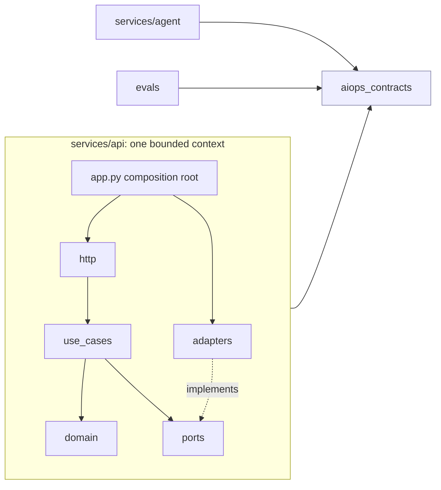

# Codebase architecture

How the code is organised, and the rules that keep it navigable for people and
coding agents. The *what* and *why* of the product lives in
[`healthcare-aiops-plan.md`](healthcare-aiops-plan.md); decisions live in
[`adr/`](../adr/README.md).

## Where does X go?

| I need to… | Put it in |
|---|---|
| Add or change a simulated service, tier or dependency | `sim/services.yaml` (validated by `aiops_contracts.catalogue`) |
| Change how a simulated service behaves | `sim/src/aiops_sim/app.py` (tests: `sim/tests/test_estate.py`) |
| Change estate placement, limits or tuning | `sim/src/aiops_sim/manifests.py`, then `make manifests` |
| Add or change a demo/eval scenario | `sim/scenarios/S<n>-<slug>.yaml` (validated by `aiops_contracts.scenarios`) |
| Add a value shared by more than one process (enum, payload, LLM output schema) | `packages/contracts/src/aiops_contracts/` |
| Add an API endpoint | `services/api/src/aiops_api/<context>/http.py` → calls a use case in `<context>/use_cases.py` |
| Add business rules for incidents, approvals, etc. | `services/api/src/aiops_api/<context>/domain.py` |
| Talk to Postgres, Prometheus, Loki, Kubernetes | An adapter in `<context>/adapters/`, implementing a port from `<context>/ports.py` |
| Wire adapters into use cases | `services/api/src/aiops_api/app.py` (composition root, the only place that does) |
| Add an agent graph node, prompt or MCP tool | `services/agent/` (arrives in week 3) |
| Add a frontend screen | `apps/web/src/app/features/<feature>/`, following `docs/design/frontend-design.md` (routes, stores, components) |
| Add a reusable UI component (badge, chip, card) | `apps/web/src/app/shared/ui/`, matching its C-code in the design spec |
| Change LLM pricing or usage accounting | `config/model-prices.yaml`; schema and budget rules in `aiops_contracts/usage.py`; capture in `services/agent/src/aiops_agent/usage.py`; storage and `/api/budget/today` in `services/api/src/aiops_api/usage/` |
| Change the database schema | A new Alembic revision in `services/api/migrations/versions/`, then `make migrate` |
| Record a decision | `docs/adr/NNNN-<slug>.md` |
| Change what is deployed | `deploy/base/` (all environments) or `deploy/overlays/demo/` (owezzy-db only) |
| Write documentation | The matching Diátaxis folder in `docs/`; link it from `docs/README.md` |

## Repository map

```text
packages/contracts/   aiops_contracts: shared vocabulary + schemas (pydantic, no I/O beyond YAML)
services/api/         aiops_api: FastAPI domain API (bounded contexts, hexagonal inside)
services/agent/       aiops_agent: LangGraph graph served over AG-UI (spike now; investigation graph week 3)
services/copilot-runtime/  Node: CopilotKit runtime, browser-facing AG-UI proxy (ADR-0004)
services/executor/    allowlisted K8s actions, scoped creds    (week 5)
sim/                  services.yaml, scenarios/, aiops_sim (demo services, load generator, manifest generator)
evals/                datasets, telemetry snapshots, runners, reports  (week 4)
apps/web/             Angular 22 (Fuse template) + CopilotKit; nginx image is the public entry point
config/               model-prices.yaml (LLM cost)
deploy/               Kustomize base + overlays/demo, Flux objects (ADR-0009, ADR-0012)
docs/                 Diátaxis: tutorials/, how-to/, reference/, explanation/; plus adr/, design/, blog/
```

Directories appear when their first real code does. Do not create empty scaffolding.

## Python: dependency rules



1. **`aiops_contracts` depends on nothing in this repo.** Everything may depend on it. It holds what crosses a process or file boundary: enums, the catalogue, scenarios, and later the `Findings` schema and API payloads. Pydantic is allowed here because these *are* boundary schemas.
2. **Services never import each other.** `api`, `agent` and `executor` talk over HTTP/MCP using `aiops_contracts` types.
3. **Inside a service, organise by bounded context first, then by layer.** Contexts in `api`: `usage` (LLM usage and the daily budget, built), `ingestion` (Alertmanager webhook, built), `correlation` (alerts to incidents, built; worker process), `incidents` (incidents, problems, changes, correlation), `governance` (approvals, policy, audit). A context folder looks like:

   ```text
   aiops_api/incidents/
     domain.py      # entities, value objects, state machine; stdlib + aiops_contracts only
     ports.py       # typing.Protocol interfaces the use cases need (repositories, clocks, clients)
     use_cases.py   # application logic; depends on domain + ports, never on adapters
     http.py        # FastAPI router: parse request -> call use case -> map response
     adapters/      # postgres.py, prometheus.py ... implement ports
   ```

   Start with single files; split a file into a package only when it grows past about 300 lines.
4. **Dependencies point inward:** `http` → `use_cases` → `domain`. `domain.py` and `use_cases.py` never import FastAPI, SQLAlchemy or HTTP clients.
5. **Domain entities are plain dataclasses,** not Pydantic or ORM models. Adapters map rows to entities. Contracts (Pydantic) are converted at the `http` edge.
6. **A port exists only when it has two implementations:** the real adapter and the in-memory fake used by use-case tests. Don't add interfaces for things that are only ever called one way.
7. **Contexts talk through use cases, never through each other's tables.** For example, `governance` asks `incidents` to move an incident to `mitigating` through an `incidents` use case.

### Testing layers

| Layer | Test with | Needs |
|---|---|---|
| `aiops_contracts` | Unit tests against the real `sim/` files | Nothing |
| `domain`, `use_cases` | Unit tests with in-memory port fakes | Nothing (no DB, no Docker) |
| `adapters` | Integration tests | Postgres via testcontainers |
| `http` | `TestClient` on `create_app()` with fakes injected | Nothing |
| Agent behaviour | `evals/` on replayed snapshots | LLM API key, spend cap |

### Agent-safety invariants (enforced in code, tested in CI)

- The agent has **no** execution tool. `propose_action` only records a pending approval (ADR-0002).
- Only `services/executor` holds Kubernetes write credentials, scoped to namespace `estate`.
- Blast radius and correlation are deterministic (`Catalogue.dependents_of`, the correlator), never LLM output (ADR-0005).
- Every action the executor runs must match an approval hash, unexpired, re-checked at execution time.

## Frontend: `apps/web`

The base is the Fuse Angular template (Angular 22, Angular Material, Tailwind, Transloco, Vite).

```text
src/@fuse/          vendor template library. Do not edit; wrap it instead.
src/app/layout/     app shell (nav, top bar, role switcher, budget meter)
src/app/core/       app-wide singletons: auth, API client, navigation, interceptors
src/app/shared/ui/  presentational building blocks reused across features
                    (severity-badge, tier-badge, evidence-chip, confidence-pill, status-stepper)
src/app/features/<feature>/
  <feature>.routes.ts       lazy-loaded route config
  data-access/              <feature>.store.ts (NgRx SignalStore), API calls
  pages/                    routed container components (inject the store)
  ui/                       presentational components (inputs/outputs only, no store)
  <feature>.models.ts       view models mapped from API types
```

Features: `incidents`, `approvals`, `problems-changes`, `scenarios`, `evals`, `audit`, `assistant` (CopilotKit panel). The template's `modules/admin/example` and `mock-api` are removed feature by feature as real ones replace them.

### State: NgRx SignalStore where it earns its place (ADR-0010)

| State | Use |
|---|---|
| Shared across routes or components, or with async workflows (incident list + filters, approval inbox with polling and countdowns, live scenario run progress, current user and role) | `signalStore` in `features/<f>/data-access/` with `withState`, `withComputed`, `withMethods`, plus `rxMethod` or `resource` for I/O |
| Local UI state (a toggle, an open drawer, form input) | A component `signal()` |
| Server data used by one component only | `httpResource` / `resource` in the component |

Rules:
- Pages inject stores; `ui/` components never do.
- Stores call the generated API client (from FastAPI's OpenAPI), never raw URLs.
- Components use `ChangeDetectionStrategy.OnPush`, signal inputs and `@if`/`@for` control flow.

## Naming

- Ubiquitous language from the plan, used identically in code, API and UI: *incident, problem, change, finding, evidence, hypothesis, proposal, approval, execution, verification, component, tier, blast radius, scenario, variant*.
- Python: `snake_case` modules named after the domain concept (`approvals.py`, not `utils.py` or `helpers.py`).
- Scenario files: `S<n>-<kebab-slug>.yaml`. Component IDs: kebab-case, matching Kubernetes names.
- Angular: `kebab-case.component.ts`, one component per file, selectors prefixed `app-`.

## Commands

All commands live in the root `Makefile` (`make help`):

```bash
make install   # uv sync + npm ci for the runtime and web app
make dev       # agent :8123 + runtime :4000 + web :5173 together (Ctrl-C stops all)
make test      # Python tests
make lint      # ruff + runtime typecheck
make check     # lint + test + Angular build (what CI runs)
make help      # every target, incl. agent/runtime/web/api individually
```
